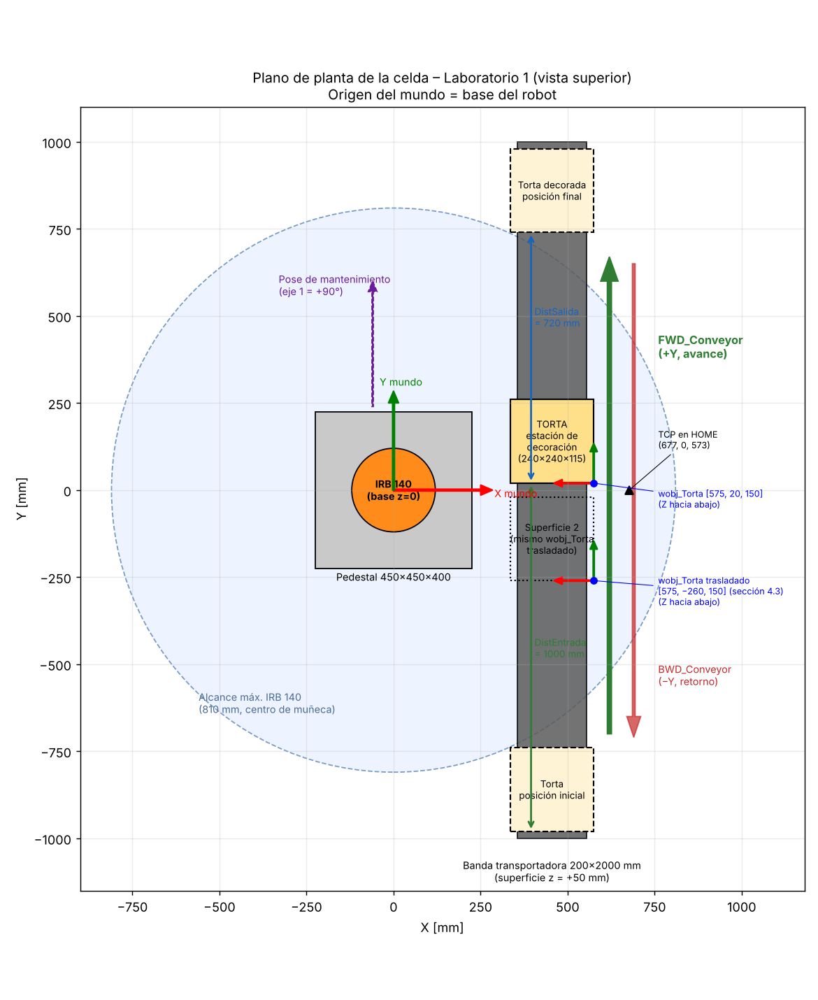
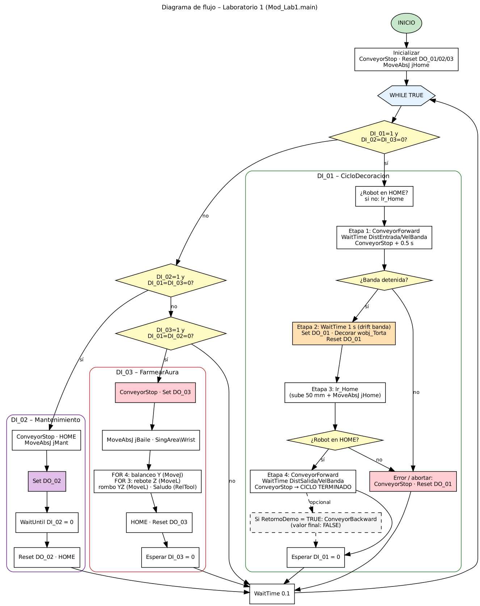
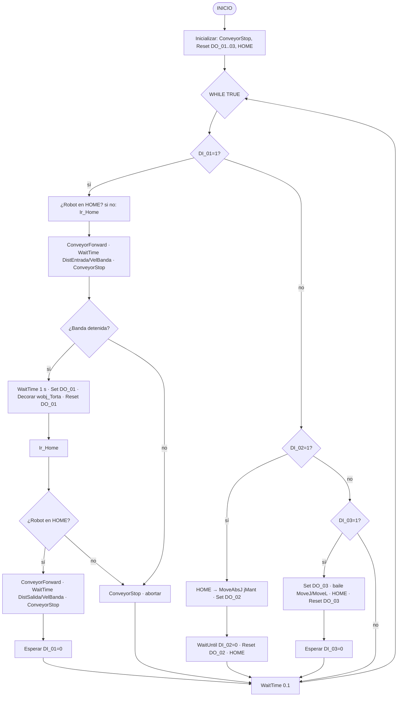
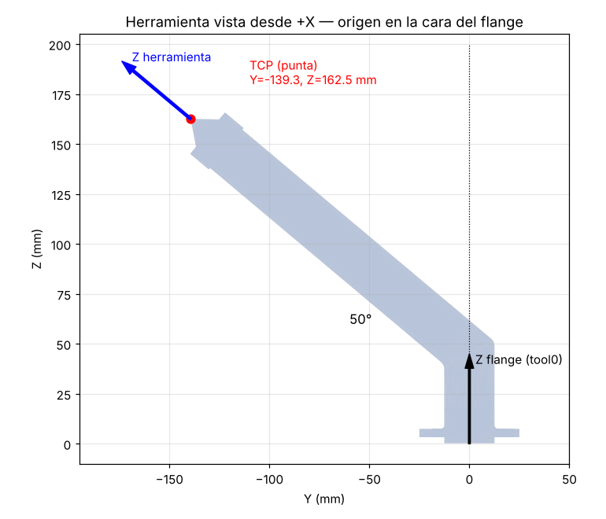
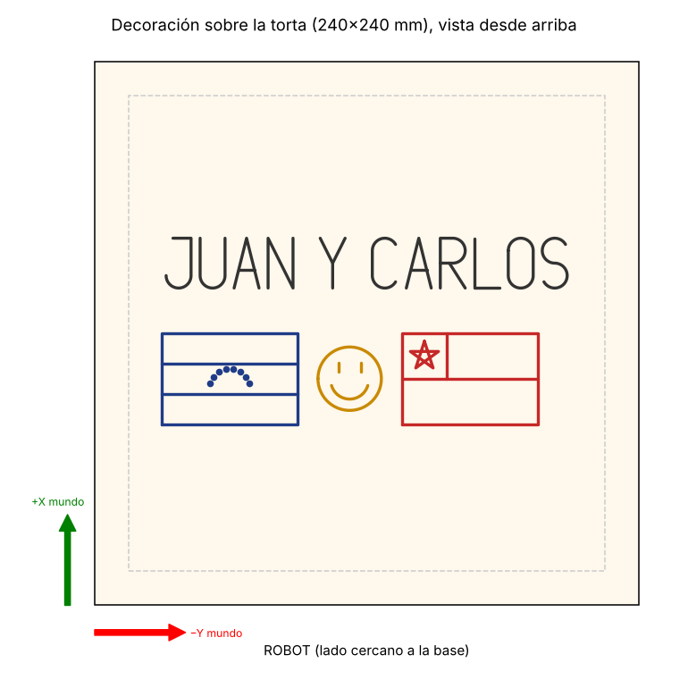
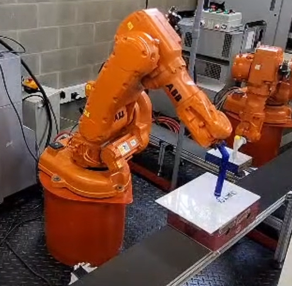
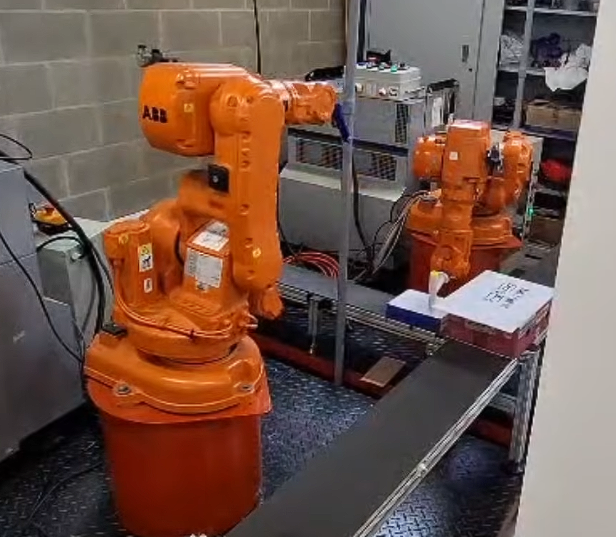
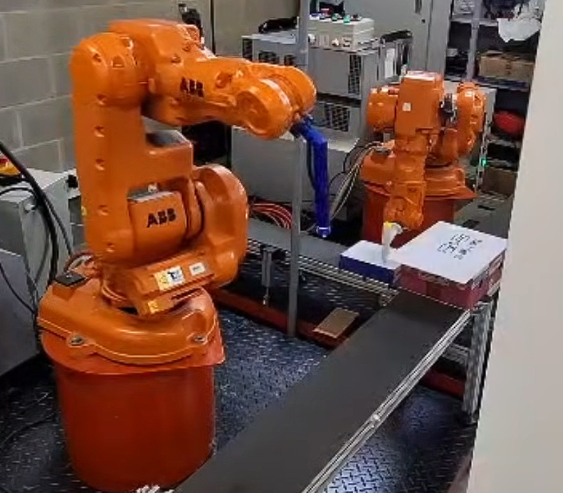
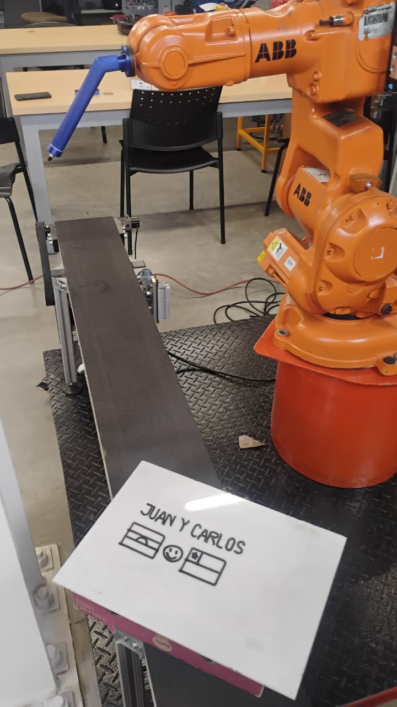

# Laboratorio 1 – Robótica Industrial: Trayectorias, Entradas y Salidas Digitales

**Universidad Nacional de Colombia – LabSIR · Robótica 2026-II**
**Integrantes:** Juan · Carlos
**Robot:** ABB IRB 140 (6 kg / 0.81 m) con controlador IRC5 · **Software:** RobotStudio

> 📺 **Video de la práctica (canal oficial LabSIR):** [https://www.youtube.com/watch?v=hhs1zhrJP30](https://www.youtube.com/watch?v=hhs1zhrJP30)

---

## Contenido del repositorio

| Carpeta / archivo | Contenido |
|---|---|
| `RAPID/Mod_Lab1.mod` | Módulo único: herramienta, WorkObject y HOME; programa principal (`main`); ciclo DI_01, mantenimiento DI_02 y *Farmear Aura* DI_03; banda con enclavamientos; trayectorias de la decoración |
| `Config/EIO_Lab1_Simulacion.cfg` | Configuración de las 8 señales digitales para el controlador virtual |
| `CAD/ToolConMarcador.sat`, `.stl` | Modelo CAD de la herramienta con el marcador |
| `RobotStudio/Lab1_Decoracion.rsstn` | Estación de RobotStudio |
| `docs/img/` | Plano de planta, diagrama de flujo, diseño de la decoración y de la herramienta |
| `docs/img/evidencias/` | Fotos de la ejecución en el robot real (DI_01, DI_02, DI_03 y torta decorada) |

---

## 1. Descripción de la solución

La celda simula la decoración automática de una torta para unas 20 personas. La torta es un prisma de **240 × 240 × 115 mm** que viaja sobre una banda transportadora de 200 mm de ancho ubicada frente al robot. La torta sobresale 20 mm a cada lado de la banda.

El funcionamiento se controla con tres entradas digitales, y cada modo tiene su salida indicadora:

| Entrada | Modo | Salida indicadora |
|---|---|---|
| `DI_01` | Ciclo automático: banda → decoración → HOME → banda | `DO_01` = 1 **solo** mientras se dibuja |
| `DI_02` | Pose de mantenimiento | `DO_02` = 1 mientras el robot permanece en la pose |
| `DI_03` | Rutina *Farmear Aura* (baile de ~16 s) | `DO_03` = 1 durante toda la rutina |

La banda se controla con `FWD_Conveyor` y `BWD_Conveyor`, con enclavamientos en RAPID. La solución se validó primero en RobotStudio y después se ejecutó en el robot real del LabSIR (controlador IRC5_ABEL), donde se ajustaron la posición e inclinación del WorkObject y los tiempos de la banda.

**Posicionamiento de la torta por tiempo.** En la celda real no hay sensor de posición. La torta parte de una marca fija en un extremo de la banda, y el robot calcula cuánto tiempo debe mover la banda:

$$t = \frac{\text{distancia}}{v_{banda}} \qquad t_{entrada} = \frac{DistEntrada}{VelBanda},\quad t_{salida} = \frac{DistSalida}{VelBanda}$$

En RobotStudio no se modela la cinta. Lo que se mueve es **la caja (torta)**, con un componente inteligente de dos `LinearMover` que obedece a las mismas señales `FWD_Conveyor` y `BWD_Conveyor` y a la misma velocidad. Así, el mismo código y los mismos tiempos sirven en la simulación y en el robot real.

**Seguridad implementada en el programa:**
- El robot no decora si alguna señal de la banda está activa (`BandaEnMovimiento()`).
- La banda no se mueve si el robot no está en HOME (`RobotEnHome()`, que compara los 6 ejes con tolerancia de 1°).
- Nunca se activan `FWD_Conveyor` y `BWD_Conveyor` al mismo tiempo, y antes de cambiar de sentido la banda se detiene 0.5 s.
- Solo se atiende una rutina a la vez: cada condición exige que las otras dos entradas estén en 0.
- Si ocurre un error durante el ciclo, el manejador `ERROR` detiene la banda y apaga `DO_01`.
- Antes de decorar se espera 1 s adicional después de detener la banda, para que la inercia (drift) de la banda real no desplace la torta durante el primer trazo.
- Rutina opcional `VerificarAlcance` (basada en el Ejemplo 2 de la guía) que comprueba con `CalcJointT` las esquinas de la decoración, fuera del ciclo.

---

## 2. Plano de planta



| Elemento | Posición (sistema mundo = base del robot) |
|---|---|
| Robot IRB 140 | Base en (0, 0, 0), sobre un pedestal de 450 × 450 × 400 mm |
| Banda transportadora | x = 355…555 mm, y = −1000…1000 mm, superficie en z = +50 mm |
| Torta en la estación de decoración | x = 335…575, y = 20…260, z = 50…165 mm (cuadrante x+, y+) |
| Posición inicial de la torta | y = −980…−740 (extremo −Y de la banda) |
| Posición final de la torta | y = 740…980 (extremo +Y de la banda) |
| Superficie 2 (mismo `wobj_Torta` trasladado) | x = 335…575, y = −260…−20 (cuadrante x+, y−) |
| Sentido de avance (`FWD_Conveyor`) | +Y del mundo |

La distancia medida en la celda real entre el tornillo frontal de la base del robot y el borde de la banda es de 200 mm. Como ese tornillo está a 155 mm del eje 1, el borde de la banda queda a **x = 355 mm**.

El plano corresponde a la estación de RobotStudio. En el robot real la posición exacta de la torta se fijó con el WorkObject ajustado en la celda, `[698, 20, 183]` con una inclinación de −2° (sección 6). La diferencia con el modelo se explica en la sección 5.3.

---

## 3. Diagrama de flujo





---

## 4. Herramienta

### 4.1 Diseño



La herramienta es un porta-marcador **acodado**, diseñado en Fusion 360 y fabricado por **impresión 3D en PLA**. El marcador va dentro del tubo inclinado con un **resorte interno** que le da un pequeño recorrido axial, para tolerar errores de altura al escribir:

| Característica | Valor |
|---|---|
| Brida de montaje | Ø 50 mm, con agujeros para el patrón del flange del IRB 140 (ISO 9409-1-40-4-M6) |
| Tramo recto inicial | Sale perpendicular al flange (unos 50 mm) |
| Tramo inclinado | Tubo de Ø 25 mm exterior, a **50°** respecto al eje del flange |
| Alojamiento del marcador | Ø 18 mm (marcador borrable Expo), con **resorte interno** para compensar la altura |
| Salida de la punta | La punta sobresale unos 12 mm del tubo |
| Masa estimada | 0.1 kg (volumen del modelo ≈ 94 cm³, incluido el marcador) |
| Centro de gravedad estimado | (52, 0, 82) mm en el sistema del flange |

**¿Por qué acodada?** Con la herramienta montada con el codo hacia abajo (robot en HOME), el marcador apunta hacia la mesa sin que la muñeca tenga que doblarse al límite. El robot dibuja con la muñeca en una postura cómoda, lejos de la singularidad de muñeca (eje 5 = 0°) y del brazo.

**¿Por qué el resorte?** El programa baja la punta **2 mm por debajo** de la superficie (`zPen`). El resorte absorbe esos milímetros y los errores de altura de la torta y de la calibración, así el trazo es continuo y la herramienta no se rompe.

### 4.2 Datos de la herramienta (`tooldata`)

El origen del CAD está en el centro de la cara que toca el flange. Midiendo la punta del marcador en el modelo se obtiene:

```
PERS tooldata tool_Marcador:=[TRUE,[[139.3,0,162.5],[0.906307787,0,0.422618262,0]],[0.1,[52,0,82],[1,0,0,0],0,0,0]];
```

- **Posición del TCP:** (139.3, 0, 162.5) mm desde el flange.
- **Orientación:** rotación de 50° alrededor de Y (cuaternión `[cos 25°, 0, sin 25°, 0]`). Así, el eje Z de la herramienta coincide con el eje del marcador y sale por la punta.
- **Montaje físico:** el codo de la herramienta queda **hacia abajo con el robot en HOME**. En el robot real debe montarse igual; si se monta girada a otro agujero, el `tooldata` deja de ser válido.

---

## 5. Calibración de la herramienta: RobotStudio vs. robot real

### 5.1 Definición en RobotStudio

El TCP se definió a partir del modelo CAD (*Modelado → Crear herramienta*), midiendo la punta del marcador respecto al centro de la cara del flange:

| Parámetro | Valor (CAD / RobotStudio) |
|---|---|
| Posición del TCP [mm] | (139.3, 0, 162.5) |
| Orientación (cuaternión) | [0.90631, 0, 0.42262, 0] (50° en Y) |
| Masa [kg] | 0.1 |
| Centro de gravedad [mm] | (52, 0, 82) |

### 5.2 Calibración en el robot real

**La calibración física del TCP no se realizó durante la práctica.** En el robot real se trabajó con el mismo `tooldata` obtenido del CAD, por lo que no se cuenta con valores medidos para comparar.

El procedimiento previsto era el método **TCP & Z** del FlexPendant (*Jogging → Tool → Define → TCP and Z*):

1. Fijar una punta de referencia en la mesa.
2. Llevar la punta del marcador a la referencia desde **4 orientaciones** bien diferentes (separadas al menos 30–45°) y guardar cada punto.
3. Mover el robot sobre el eje del marcador para definir la dirección **Z**.
4. Leer el TCP calculado y el **error medio y máximo** que reporta el FlexPendant.

Se escoge **TCP & Z**, y no solo *TCP (default orient.)*, porque la herramienta es acodada. El método simple deja la orientación igual a la de `tool0` y el eje Z de la herramienta no quedaría a lo largo del marcador. Las trayectorias están programadas con ese eje perpendicular a la torta.

### 5.3 Análisis: efecto de no calibrar el TCP

Al no calibrar el TCP, cualquier diferencia entre la herramienta impresa y el CAD quedó **absorbida por el WorkObject**. El WorkObject se ajustó en la celda real usando el TCP del CAD, así que el error de la herramienta se compensó desplazando el sistema de referencia de la torta. Esto explica, al menos en parte, por qué el WorkObject final del robot real, `[698, 20, 183]` con −2° de inclinación, difiere del de la simulación (`[575, 20, 165]`, sin inclinación). La otra parte se debe a que la posición real de la banda y de la torta no coincide exactamente con el modelo. Con los datos disponibles no es posible separar las dos contribuciones.

Las fuentes de diferencia esperadas entre el TCP del CAD y el real son:

1. **Tolerancias de la impresión 3D en PLA:** contracción del material y ángulo real del codo distinto de 50°. Un error de 1° en el codo desplaza la punta unos 3–4 mm, porque el tramo inclinado mide ~200 mm.
2. **Asiento del marcador y resorte:** el marcador puede quedar unos milímetros más adentro o más afuera que en el modelo, y el resorte cambia la longitud efectiva con la fuerza de contacto.
3. **Geometría real del marcador:** la punta del Expo es biselada y no cónica como en el modelo.
4. **Holguras de montaje:** tornillos M6 sobre plástico y flexión de la pieza impresa.

La compensación por WorkObject fue suficiente para que la decoración saliera completa y legible (sección 15). Sin embargo, solo es válida mientras la herramienta no se desmonte y se use con la misma orientación. Si se cambia el marcador o se reinstala la herramienta, habría que repetir el ajuste. Con una calibración TCP & Z, en cambio, bastaría con recalibrar la herramienta sin tocar el WorkObject.

---

## 6. WorkObject

Toda la decoración se programa respecto a un único WorkObject en la esquina superior de la torta. Valor final usado en el robot real:

```
TASK PERS wobjdata wobj_Torta:=[FALSE,TRUE,"",[[698,20,183],[0.017452,0,0.999848,0]],[[0,0,0],[1,0,0,0]]];
```

- **Origen** en la esquina superior lejana de la torta, en la estación de decoración (cuadrante x+, y+).
- **Orientación** base `[0,0,1,0]` (180° alrededor de Y): X hacia el robot, Y a lo largo de la banda y **Z hacia abajo**, dentro de la torta.
- En el robot real se añadió una inclinación de **−2° alrededor de Y** (orientación final `[0.017452, 0, 0.999848, 0]`). Así se igualó la presión del marcador entre el borde de la torta cercano al robot y el lejano: en 240 mm, 2° equivalen a unos 8 mm de diferencia de altura.
- La herramienta trabaja con sus ejes **paralelos a los del WorkObject**: el punto de referencia `pRef` tiene orientación `[1,0,0,0]`.

### Reutilización en el cuadrante x(+), y(−) (sección 4.3)

No se crean trayectorias nuevas ni otro WorkObject. **Solo se modifican las coordenadas del sistema de referencia** `wobj_Torta` y se ejecuta la misma rutina `Decorar`:

```
posOriginal := wobj_Torta.uframe.trans;          ! posición de la estación
wobj_Torta.uframe.trans := posTortaYneg;         ! nueva ubicación: x(+), y(−)
Decorar wobj_Torta;                              ! mismas trayectorias, sin cambiar ningún punto
Ir_Home;
wobj_Torta.uframe.trans := posOriginal;          ! se restaura la estación sobre la banda
```

Esto está implementado en la rutina `Demo_CambioCoordenadas`. Su manejador `ERROR` restaura las coordenadas aunque ocurra una falla. Como todos los puntos del dibujo son `Offs(pRef, …)` relativos al WorkObject, trasladarlo 280 mm en −Y basta para que el mismo dibujo aparezca en la otra superficie.

En RobotStudio la alternativa equivalente es editar las coordenadas de `wobj_Torta` (clic derecho → *Modificar objeto de trabajo*) y volver a ejecutar `Decorar`.

Para la celda real, la posición del WorkObject en el cuadrante x(+), y(−) es `posTortaYneg` = `[698, −260, 183]`: misma x, misma z y misma inclinación que la estación sobre la banda, desplazada 280 mm en −Y.

---

## 7. Decoración



- **Nombres:** **JUAN Y CARLOS**, en letras mayúsculas de trazo continuo de 22 mm de alto, con 12 mm entre palabras.
- **Decoración libre:**
  - Bandera de **Venezuela** bajo JUAN: contorno, dos franjas y 8 estrellas como puntos en arco.
  - Bandera de **Chile** bajo CARLOS: contorno, franja, cuartel y estrella de 5 puntas de un solo trazo.
  - **Carita feliz** en el centro.

**Cómo está programada.** Hay un único `robtarget` (`pRef`, en el origen del WorkObject), y cada punto del dibujo es `Offs(pRef, x, y, z)` en mm. Cada trazo sigue el mismo patrón:

```
MoveL Offs(pRef,x0,y0,zSeg),vAire ,zAire,tool_Marcador\WObj:=wobj;  ! 1. se ubica 15 mm encima
MoveL Offs(pRef,x0,y0,zPen),vTrazo,fine ,tool_Marcador\WObj:=wobj;  ! 2. baja y apoya (2 mm de compresión)
MoveL/MoveC ... zPen, vTrazo, zTrazo ...                             ! 3. dibuja (v100, z1)
MoveL Offs(pRef,x1,y1,zSeg),vAire ,zAire,tool_Marcador\WObj:=wobj;  ! 4. sube y se retira
```

| Parámetro | Valor | Cumplimiento |
|---|---|---|
| Velocidad de trazo | `v100` | v100…v1000 ✔ |
| Velocidad en el aire | `v400` | ✔ |
| Zona en el trazo | `z1` (`fine` al apoyar y al levantar) | ≤ z10 ✔ |
| Zona en el aire | `z5` | ≤ z10 ✔ |
| Inicio y fin | HOME | ✔ |

Las curvas (J, U, C, O, S, círculo de la carita y sonrisa) se hacen con `MoveC`. Las rectas se hacen con `MoveL`.

---

## 8. Entradas, salidas y banda transportadora

### 8.1 Señales

| Señal | Tipo | Función |
|---|---|---|
| `DI_01` | Entrada digital | Inicia el ciclo automático |
| `DI_02` | Entrada digital | Pose de mantenimiento (mantener en 1) |
| `DI_03` | Entrada digital | Rutina *Farmear Aura* |
| `DO_01` | Salida digital | "Robot decorando" |
| `DO_02` | Salida digital | "Robot en posición de mantenimiento" |
| `DO_03` | Salida digital | "Robot Farmando Aura" |
| `FWD_Conveyor` | Salida digital | Banda hacia adelante (+Y) |
| `BWD_Conveyor` | Salida digital | Banda hacia atrás (−Y) |

### 8.2 Control bidireccional y enclavamientos

| Estado | FWD_Conveyor | BWD_Conveyor | Procedimiento |
|---|---|---|---|
| Adelante | 1 | 0 | `ConveyorForward` |
| Atrás | 0 | 1 | `ConveyorBackward` |
| Detenida | 0 | 0 | `ConveyorStop` |
| **Prohibido** | 1 | 1 | Bloqueado por programa |

- `ConveyorForward` y `ConveyorBackward` verifican con `DOutput()` el sentido contrario. Si estaba activo, detienen la banda, esperan `tCambioSentido` = 0.5 s, apagan la señal contraria y **vuelven a verificar** antes de activar la nueva.
- `MoverBanda(distancia, adelante)` solo mueve la banda si `RobotEnHome()` es verdadero.
- El parámetro `RetornoDemo` permite que, al terminar el ciclo, la banda devuelva la torta al inicio con `BWD_Conveyor`. **Valor final: `FALSE`**: el ciclo termina con la torta en el extremo final, tal como describe la guía. El sentido `BWD_Conveyor` se demuestra en el video.

### 8.3 Parámetros de la banda

| Parámetro | Simulación | Robot real (valor final) |
|---|---|---|
| `VelBanda` [mm/s] | 100 | 100 |
| `DistEntrada` [mm] | 1000 → *t* = 10 s | 500 → *t* = 5 s |
| `DistSalida` [mm] | 720 → *t* = 7.2 s | 500 → *t* = 5 s |
| `tAsentamiento` [s] | 0.5 | 0.5 |
| Espera antes de decorar [s] | — | 1 (drift de la banda) |
| `RetornoDemo` | TRUE | FALSE |

En el robot real los tiempos se ajustaron experimentalmente: se modificaron `DistEntrada` y `DistSalida` hasta que la torta se detuviera en la estación de decoración, manteniendo `VelBanda` = 100 como parámetro de referencia. Además, se observó que la banda sigue desplazándose un poco después de apagar la señal. Por eso se añadió una espera de 1 s antes de iniciar la decoración.

Un error de tiempo de 0.1 s a 100 mm/s equivale a 10 mm de error de posición. El dibujo tiene unos 30 mm de margen respecto a los bordes de la torta, así que esa tolerancia es aceptable.

---

## 9. Pose de mantenimiento (DI_02)

```
CONST jointtarget jMant:=[[90,0,0,0,0,0],[9E+09,...]];
```

1. El robot va primero a HOME y luego gira el eje 1 a +90°, hacia el lado libre de la celda, lejos de la banda.
2. El brazo queda horizontal, con el flange a unos 1.1 m del piso, cómodo para cambiar o ajustar el marcador, retirar la herramienta o inspeccionarla.
3. `DO_02 = 1` al llegar a la pose. El robot permanece ahí mientras `DI_02 = 1`.
4. Al poner `DI_02 = 0`, se apaga `DO_02` y el robot vuelve a HOME.

En la celda real, verificar que el lado +Y del robot esté libre. Si no lo está, usar `jMant` con el eje 1 en −90.

---

## 10. Rutina *Farmear Aura* (DI_03)

Coreografía de unos 16 s alrededor de una pose central `jBaile` (HOME con el eje 5 a 30°). El movimiento es **casi nulo en X** y se concentra en **Y y Z**:

| Paso | Movimiento | Instrucción | Estructura |
|---|---|---|---|
| 1 | "Se levanta": sube 60 mm | `MoveJ` | — |
| 2 | Balanceo lateral ±120 mm en Y con un *dip* en Z | `MoveJ` | `FOR` (4 veces) + `IF` (alterna el lado con `MOD`) |
| 3 | Rebote vertical +80 / −40 mm en Z | `MoveL` | `FOR` (3 veces) |
| 4 | Rombo en el plano YZ | `MoveL` | — |
| 5 | "Saludo": gira el marcador ±25° sobre su eje | `MoveL` + `RelTool` | Procedimiento `Saludo(veces)` con `FOR` |
| 6 | Regreso a HOME | `MoveAbsJ` | — |

- Velocidad del baile: 300 mm/s (`vBaile`). El saludo usa 60 °/s de reorientación (`vSaludo`). Zonas `z10`.
- **¿Por qué `jBaile` y no HOME?** En HOME el eje 5 está en 0°, que es una singularidad de muñeca, y los `MoveL` cerca de ese punto pueden fallar. Con el eje 5 a 30° y `SingArea\Wrist` el baile es estable.
- Se ejecuta con la banda detenida. `DO_03` está activa desde el inicio hasta que el robot vuelve a HOME.
- Si la duración medida queda fuera de 10–20 s, se ajusta la velocidad (`vBaile`) o el número de repeticiones de los `FOR`.

---

## 11. Instrucciones y funciones de RAPID utilizadas

| Instrucción / función | Uso en el programa |
|---|---|
| `MoveJ` | Aproximación a la torta y balanceo del baile (movimiento articular) |
| `MoveL` | Trazos rectos, aproximación y retiro vertical, baile lineal |
| `MoveC` | Arcos de las letras y de la carita feliz |
| `MoveAbsJ` | HOME, pose de mantenimiento y pose del baile (por ejes) |
| `Offs(p, dx, dy, dz)` | Desplaza un `robtarget` en los ejes del WorkObject: todos los puntos del dibujo y del baile |
| `RelTool(p, dx, dy, dz \Rz)` | Gira la herramienta sobre su propio eje (saludo) |
| `CRobT(\Tool \WObj)` | Lee la posición actual del TCP (retiro seguro y base del baile) |
| `CJointT()` | Lee los ángulos actuales de los ejes (verificar HOME) |
| `CalcJointT` | Verifica que las esquinas del dibujo sean alcanzables |
| `ConfJ \Off` / `ConfL \Off` | Permite que el robot escoja la configuración más cercana |
| `SingArea \Wrist` | Permite pasar cerca de la singularidad de muñeca en el baile |
| `Set` / `Reset` | Activar y desactivar salidas (DO y banda) |
| `DOutput()` | Leer el estado de una salida (enclavamientos) |
| `WaitTime` | Tiempos de la banda, asentamiento, espera por drift y cambio de sentido |
| `WaitUntil` | Esperar a que se libere una entrada (DI_02, DI_01, DI_03) |
| `TPWrite` / `TPErase` | Mensajes al operador en el FlexPendant |
| `WHILE`, `FOR`, `IF/ELSEIF`, `MOD` | Bucle principal, repeticiones del baile, selección de modo |
| `PROC` / `FUNC` | Procedimientos y funciones booleanas (`RobotEnHome`, `BandaEnMovimiento`, `TortaAlcanzable`) |
| `ERROR`, `ERRNO`, `RAISE`, `TRYNEXT` | Manejo de errores: banda detenida si falla el ciclo, alcanzabilidad |
| `PERS` / `CONST` / `VAR` | Parámetros ajustables (banda) y datos fijos (posiciones) |
| `tooldata`, `wobjdata`, `robtarget`, `jointtarget`, `speeddata` | Tipos de datos de herramienta, sistema de trabajo, puntos y velocidades |

---

## 12. Código completo

- [`RAPID/Mod_Lab1.mod`](RAPID/Mod_Lab1.mod): módulo único organizado en 5 secciones:
  1. Datos de herramienta, WorkObject, HOME y decoración.
  2. Datos de la banda, poses y velocidades.
  3. Programa principal y rutinas DI_01, DI_02 y DI_03.
  4. Control de la banda con enclavamientos.
  5. Trayectorias de decoración.

---

## 13. Cómo ejecutar la simulación en RobotStudio

**1. Señales.** *Controlador → Configuración → Cargar parámetros* → `Config/EIO_Lab1_Simulacion.cfg` → *Cargar parámetros y reemplazar duplicados* → reiniciar el controlador.
- También se pueden crear a mano: *Configuración → I/O System → Signal → Nueva señal*, con el tipo *Digital Input* para `DI_0x` y *Digital Output* para el resto.

**2. Módulos RAPID.**
- Descargar los módulos anteriores y cargar `RAPID/Mod_Lab1.mod`.
- Quitar el `main` de `Module1`: solo puede existir un `main`.
- Clic en **Aplicar**.

**3. Torta.**
- Hacer visible `Torta_1` (clic derecho → *Visible*).
- *Fijar posición* en **[0, −DistEntrada, −400]** respecto al mundo, para que la torta recorra exactamente `DistEntrada` hasta la estación. Con los valores finales del código (`DistEntrada` = 500) es **[0, −500, −400]**; con los de la simulación original (1000) era [0, −1000, −400].

**4. Componente inteligente `SC_Banda`** (*Modelado → Componente inteligente*):
- Agregar dos *LinearMover*:
  - `LM_FWD`: Object = `Torta_1`, Direction = (0, 1, 0), Speed = 100 mm/s, Reference = Global.
  - `LM_BWD`: Object = `Torta_1`, Direction = (0, −1, 0), Speed = 100 mm/s, Reference = Global.
- Crear dos entradas digitales en el componente, `FWD` y `BWD`, y conectarlas: `FWD → LM_FWD.Execute` y `BWD → LM_BWD.Execute`.

**5. Lógica de estación** (*Simulación → Lógica de estación → Señales y conexiones*):
- `Controlador_Lab1.FWD_Conveyor → SC_Banda.FWD`
- `Controlador_Lab1.BWD_Conveyor → SC_Banda.BWD`

**6. Estado inicial.** *Simulación → Restablecer → Guardar estado actual*, incluyendo la torta. Antes de cada prueba se restablece ese estado.

**7. Ejecución.**
- *Configuración de simulación* → punto de entrada `main` → **Reproducir**.
- En el *Simulador de E/S*:
  - Poner `DI_01` = 1 para el ciclo. Cuando el FlexPendant lo pida, volver a 0.
  - Mantener `DI_02` = 1 para mantenimiento, y ponerla en 0 para salir.
  - Poner `DI_03` = 1 para el baile, y volver a 0 al terminar.

> La velocidad de los `LinearMover` debe ser igual a `VelBanda`. Si se cambia una, se cambia la otra.

---

## 14. Paso al robot real (sección 4.9)

| Verificación | Estado |
|---|---|
| Señales `DI_0x`, `DO_0x`, `FWD_Conveyor`, `BWD_Conveyor` | Ya existían en el controlador real, mapeadas al módulo **DSQC_652** con los mismos nombres; el código no requirió cambios |
| Herramienta montada con el **codo hacia abajo en HOME** | Realizado |
| Calibración del TCP (TCP & Z) | **No realizada**; se usó el TCP del CAD (sección 5) |
| `wobj_Torta` | Ajustado en la celda: `[698, 20, 183]`, −2° en Y |
| Tiempos de la banda | Ajustados experimentalmente (sección 8.3) |
| Primeras pruebas | Modo manual y velocidad reducida, con la parada de emergencia a la mano |
| Programa cargado | Módulo único `Mod_Lab1.mod` en el controlador IRC5_ABEL |

---

## 15. Evidencias

### 15.1 Ejecución en el robot real

| DI_01: ciclo de decoración (`DO_01`) | DI_02: pose de mantenimiento (`DO_02`) | DI_03: *Farmear Aura* (`DO_03`) |
|---|---|---|
|  |  |  |

**Resultado de la decoración:**



La torta muestra "JUAN Y CARLOS", la bandera de Venezuela, la carita feliz y la bandera de Chile, igual que el diseño de la sección 7.

### 15.2 Video

El video completo, en el canal oficial del LabSIR, muestra el funcionamiento de todas las señales:

| Requisito | Dónde se ve |
|---|---|
| Transporte inicial del pastel / `FWD_Conveyor` | Etapa 1 del ciclo DI_01 |
| Detención de la banda en la estación | Fin de la etapa 1 |
| Decoración + `DO_01` | Etapa 2 (DO_01 encendida solo durante el dibujo) |
| Retorno a HOME | Etapa 3 |
| Transporte del pastel decorado | Etapa 4 |
| `BWD_Conveyor` (bidireccional) | Demostración del sentido contrario de la banda |
| Pose de mantenimiento + `DO_02` | DI_02 |
| *Farmear Aura* + `DO_03` | DI_03 |

📺 **Enlace:** [https://www.youtube.com/watch?v=hhs1zhrJP30](https://www.youtube.com/watch?v=hhs1zhrJP30)

---

## 16. Conclusiones

- Programar la decoración respecto a un WorkObject, con un único punto de referencia y desplazamientos `Offs`, permitió adaptar la rutina de la simulación al robot real **sin modificar ninguna coordenada del dibujo**. Solo se ajustaron la posición y la inclinación (−2°) del WorkObject en la celda. Por la misma razón, la rutina se puede reutilizar en otra superficie cambiando únicamente las coordenadas del sistema de referencia.
- La herramienta acodada impresa en PLA, con resorte interno, cumplió su función: el resorte absorbió los pequeños errores de altura y permitió trazos continuos con `zPen` = 2 mm de compresión.
- No calibrar el TCP en el robot real obligó a compensar el error de la herramienta con el WorkObject. Funcionó para esta práctica, pero la calibración TCP & Z es el procedimiento correcto, porque separa el error de la herramienta del de la posición de la pieza.
- El posicionamiento de la torta por tiempo es sencillo pero sensible a la repetibilidad de la banda: hubo que ajustar experimentalmente las distancias y añadir 1 s de espera por el desplazamiento residual (drift) de la banda después de detenerla. Un sensor de presencia en la estación eliminaría esta dependencia.
- Los enclavamientos de la banda, la verificación de HOME antes de moverla y la atención a una sola rutina a la vez permitieron operar la celda con el robot y la banda sin conflictos.
